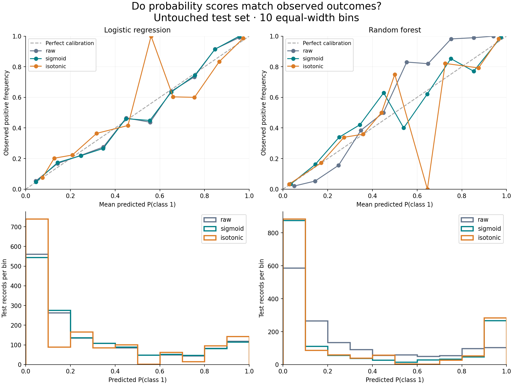
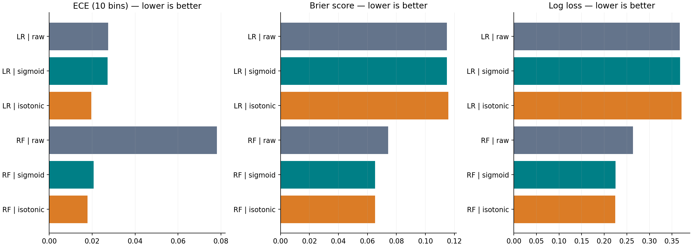

# Calibrated Probability Scoring — Experiment Report

## Objective and data
Compare probability quality before and after calibration. The reproducible synthetic
binary dataset has 10,000 rows, 20 numeric features (10 informative, 5 redundant),
nominal 70/30 class weighting, and 3% random label reassignment. Observed positive
prevalence is 30.31%. Seed: 42. It illustrates a risk/churn-style scoring
task; these are not real customers or a validated domain model. Positive class is 1.

## Method and leakage prevention
Stratified disjoint splits: 5000 training, 2000
calibration, 1500 validation, 1500 final test.
Logistic regression uses a scaler fitted only on training data. Random forest uses
200 trees, minimum leaf size 5. Hyperparameters are fixed in advance. Each fitted
base model is frozen; sigmoid (Platt-style) and isotonic mappings learn exclusively
from the calibration split. Six candidates share the same held-out sets.
The saved scorer **Random forest | sigmoid** was selected by lowest validation Brier score
(0.0615), before test evaluation. Models are not
refitted after selection. Test comparisons describe results, not a new selection rule.

## Final test results
| Model | Brier ↓ | Log loss ↓ | ECE-10 ↓ | ROC-AUC ↑ |
|---|---:|---:|---:|---:|
| Logistic regression / raw | 0.1148 | 0.3675 | 0.0274 | 0.8838 |
| Logistic regression / sigmoid | 0.1148 | 0.3676 | 0.0271 | 0.8838 |
| Logistic regression / isotonic | 0.1157 | 0.3711 | 0.0196 | 0.8822 |
| Random forest / raw | 0.0742 | 0.2638 | 0.0781 | 0.9562 |
| Random forest / sigmoid | 0.0653 | 0.2250 | 0.0207 | 0.9562 |
| Random forest / isotonic | 0.0652 | 0.2245 | 0.0178 | 0.9566 |

- Logistic regression, sigmoid: ECE changed from 0.0274 to 0.0271; Brier changed from 0.1148 to 0.1148.
- Logistic regression, isotonic: ECE changed from 0.0274 to 0.0196; Brier changed from 0.1148 to 0.1157.
- Random forest, sigmoid: ECE changed from 0.0781 to 0.0207; Brier changed from 0.0742 to 0.0653.
- Random forest, isotonic: ECE changed from 0.0781 to 0.0178; Brier changed from 0.0742 to 0.0652.

## Visual evidence

The diagonal represents agreement between mean predictions and observed frequencies.
Points above it indicate underprediction of positive probability; points below it
indicate overprediction. Histograms show support: sparse bins are less reliable.
Empty bins are omitted from curves and contribute zero to ECE. Detailed bin counts
are in reliability_bins.csv; per-row probabilities are in test_predictions.csv.

## Metrics and interpretation
ECE = sum over bins of (bin count / N) × |observed positive fraction − mean predicted
probability|. Bins are [0, .1), [.1, .2), …, [.9, 1], including probability 1 in the
last bin. This is positive-class ECE, not top-label confidence ECE. Lower is better.
ECE depends on binning and sample size; metrics.csv also includes 5- and 20-bin ECE.
Brier is mean squared probability error. Log loss strongly penalizes confident wrong
predictions. Both assess probability quality, including discrimination, rather than
calibration alone. ROC-AUC assesses ranking, not probability accuracy.

Calibration does not guarantee improvement for every model or metric. Sigmoid learns
a smooth mapping; isotonic learns a flexible monotone mapping and can overfit or
produce extreme 0/1 estimates. Isotonic may change AUC through tied scores. A model
can rank cases well yet attach inaccurate probabilities to them. Use all diagnostics,
not just a single low ECE or an attractive curve.

## Decision-making example
If false positives cost 1 unit and false negatives cost 4 units, the minimum expected
cost decision under that simple two-error-cost model uses threshold 1/(1+4) = 0.20.
At p=0.70, the predicted positive outcome should occur around 70% of the time among
comparable cases in aggregate, not with certainty for one individual. Calibration
therefore supports expected-cost decisions, risk estimates and resource planning.
The costs here are illustrative, not business advice or an optimized test threshold.

## Limitations and next steps
One synthetic dataset and one split do not establish statistical significance or
real-world readiness. No confidence intervals are claimed. In deployment, use
representative data, validate temporal/group splits where appropriate, inspect
subgroup calibration, monitor prevalence/drift, and recalibrate when necessary.
Use repeated validation or a fresh holdout before making stronger comparative claims.

## References
- Scikit-learn probability calibration guide: https://scikit-learn.org/stable/modules/calibration.html
- CalibratedClassifierCV: https://scikit-learn.org/stable/modules/generated/sklearn.calibration.CalibratedClassifierCV.html
